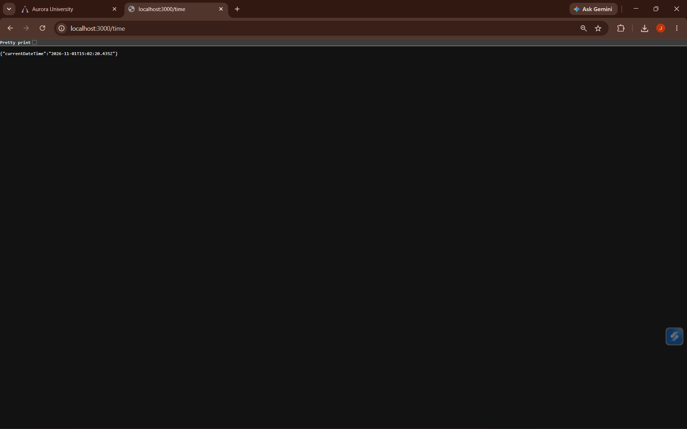
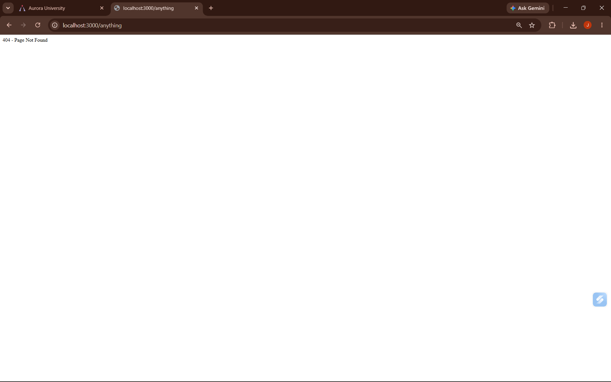

# Lab 1: Node.js and Express Server

## Student Details

| Field | Details |
|---|---|
| Name | G JESHWANTH REDDY |
| Registration Number | 252U1R9044 |
| Section | CSE-GEN-AI 2A 304 |
| Course | Backend Development Fundamentals |
| Lab | 01 |

## Live Deployment

[Open the deployed application](https://lab-1-lac.vercel.app/)

## Objective

Set up a Node.js project, create a basic HTTP server with Node.js's built-in `http` module, and build an Express server with multiple routes and appropriate HTTP status codes.

## Technologies

- **Node.js** — JavaScript runtime
- **Express.js** — Web framework for Node.js
- **JavaScript** — Programming language
- **npm** — Node.js package manager

## Project Structure

```text
.
├── screenshots/
│   ├── about.png
│   ├── anything.png
│   ├── home.png
│   └── time.png
├── server-http.js
├── server.js
├── package.json
├── package-lock.json
├── .gitignore
└── README.md
```

## Getting Started

### Prerequisites

- Node.js
- npm

### Run the Express server

1. Open the project folder in a terminal.
2. Install dependencies:

   ```bash
   npm install
   ```

3. Start the server:

   ```bash
   node server.js
   ```

4. Visit [http://localhost:3000](http://localhost:3000).

### Run the basic HTTP server

The project also includes a minimal server using Node.js's built-in HTTP module:

```bash
node server-http.js
```

Both servers use port `3000`, so stop one with `Ctrl + C` before starting the other.

## API Endpoints

| Method | Endpoint | Response | Status |
|---|---|---|---|
| `GET` | `/` | Welcome message | `200 OK` |
| `GET` | `/about` | Student name and section as JSON | `200 OK` |
| `GET` | `/time` | Current date and time as JSON | `200 OK` |
| `GET` | Any undefined path (for example, `/anything`) | `404 - Page Not Found` | `404 Not Found` |

## Screenshots

The screenshots below show the Express routes running locally at `http://localhost:3000`.

### Home — `GET /`

Returns the welcome message.


### About — `GET /about`

Returns the student name and section as JSON.


### Time — `GET /time`

Returns the current date and time as JSON.



### Not found — `GET /anything`

An undefined path returns a 404 response.



## HTTP Status Codes

| Code | Name | Meaning |
|---|---|---|
| `200` | OK | The request succeeded. |
| `404` | Not Found | The requested route does not exist. |

## Viva Questions

### 1. What is the difference between `package.json` and `node_modules`?

`package.json` stores project metadata, scripts, and dependency information. `node_modules` contains the installed packages required by the project.

### 2. What does `app.listen()` do?

`app.listen()` starts the Express server and makes it listen for incoming requests on a specified port.

### 3. What do `request` and `response` represent?

`request` contains information about the incoming HTTP request. `response` is used to send data and status codes back to the client.

## Repository Notes

- `.gitignore` excludes `node_modules/` and `.env`.
- Do not commit the `node_modules/` directory.
- Route screenshots are stored in `screenshots/`.

## Conclusion

This lab demonstrates a basic Node.js HTTP server and an Express server with multiple GET routes. The endpoints were tested with successful `200 OK` responses and a `404 Not Found` response for undefined routes.
